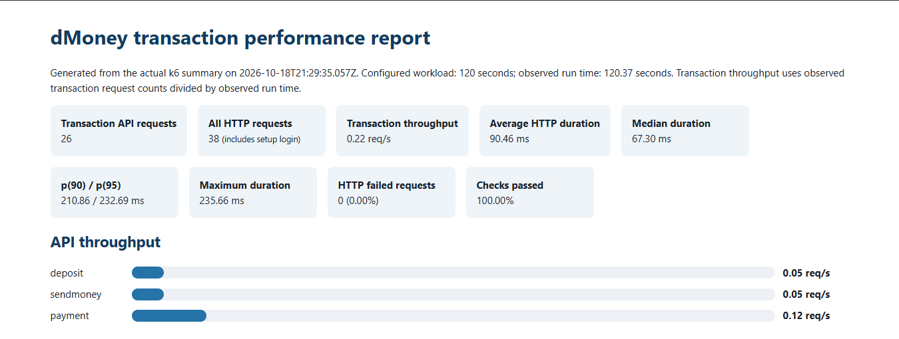
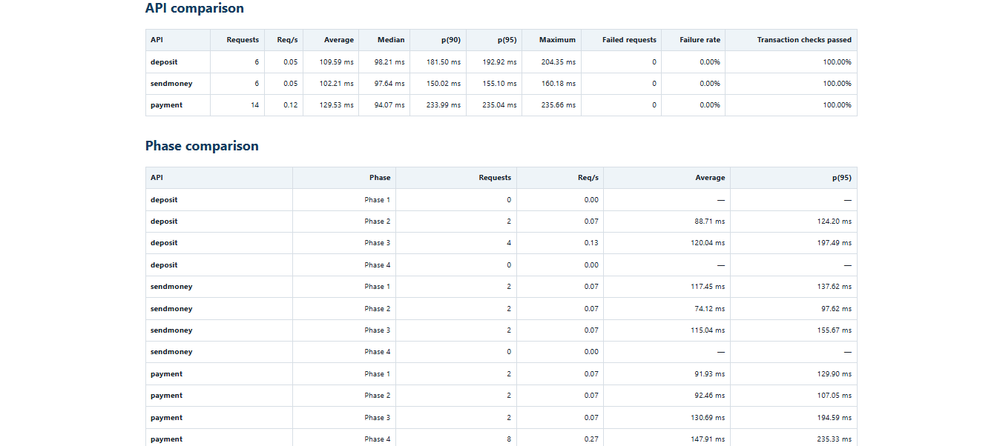
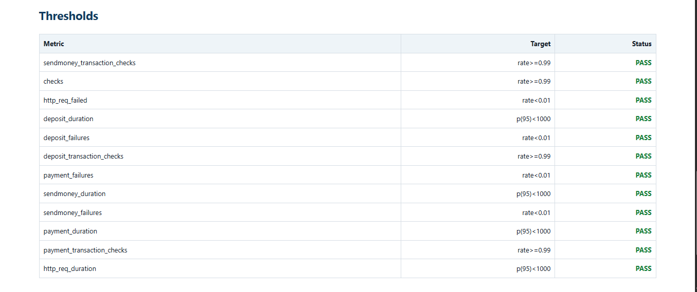
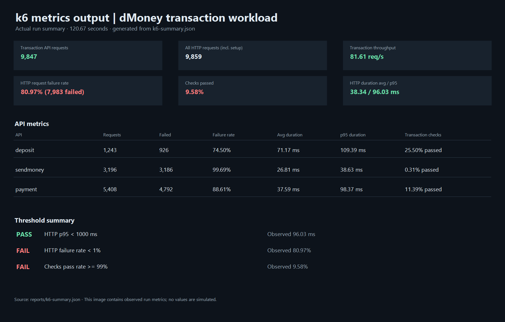

# dMoney k6 Performance Testing

Road to SDET, Batch 19 performance assignment. This project runs six independently authenticated dMoney users through the required local deposit, send-money, and payment flows for four consecutive 30-second phases.

**Author:** Kazi Abu Jafor Arif · **Email:** [kajarif02@gmail.com](mailto:kajarif02@gmail.com)

## Objectives and tools

- Exercise the local Node.js/Express dMoney API with k6 and JavaScript.
- Run independent transaction flows concurrently using k6 `constant-vus` scenarios. Each flow loops for its phase window; no arrival-rate executor is used.
- Record standard k6 HTTP metrics, per-API counters, failure/check rates, API duration trends, and phase-specific counters/trends.
- Produce a machine-readable k6 JSON summary and an offline HTML report.

Prerequisites: Node.js, k6 installed and on `PATH`, and the dMoney API plus its MySQL database running locally. The existing API starts with `npm start` from the repository root and listens on port 5000 by default (configured in the project `.env`). API paths are mounted at the root (for example, `/user/login`).

## Configure local accounts

Copy `.env.example` to `.env` in this directory and set `DMONEY_BASE_URL` to the local API. Set `DMONEY_PARTNER_KEY` to the local API's `PARTNER_KEY`. Supply six distinct active test accounts and passwords. Identifiers may be either the account's email or phone number.

The repository's model seeds one agent (`Test Agent`, phone `01686606901`), two customers (`01686606902`, `01686606903`), and one merchant (`01686606905`). It does not seed a second agent or second merchant. The model's development seed password is `1234`, but an existing database account may differ. Do not assume those seed records or passwords exist in your database; check your local setup. Create/configure the missing dedicated accounts through your normal local setup before running. Never put real secrets in source control.

| Account | Role | Required environment keys |
|---|---|---|
| Agent 1 | Agent | `AGENT1_IDENTIFIER`, `AGENT1_PASSWORD` |
| Agent 2 | Agent | `AGENT2_IDENTIFIER`, `AGENT2_PASSWORD` |
| Customer 1 | Customer | `CUSTOMER1_IDENTIFIER`, `CUSTOMER1_PASSWORD` |
| Customer 2 | Customer | `CUSTOMER2_IDENTIFIER`, `CUSTOMER2_PASSWORD` |
| Merchant 1 | Merchant | `MERCHANT1_IDENTIFIER`, `MERCHANT1_PASSWORD` |
| Merchant 2 | Merchant | `MERCHANT2_IDENTIFIER`, `MERCHANT2_PASSWORD` |

The API login accepts `{email, password}` or `{phone_number, password}` and returns a JWT directly for Admin/SYSTEM. Other roles require OTP verification. The local API implements a development bypass via `POST /user/verify-otp?env=dev` using `DEFAULT_OTP`; configure the same local value as `DMONEY_DEFAULT_OTP`. Setup logs in each account independently and verifies all six tokens before starting any transaction scenario. Tokens are held in k6 setup data and are never printed. Transaction requests send `Authorization: Bearer <token>`, `X-AUTH-SECRET-KEY`, and `Content-Type: application/json`.

## Workload phases

Each named scenario has its own `constant-vus` executor, starts at the listed boundary, runs for 30 seconds, and repeats only its single flow. One VU per flow is the default, configurable using `DMONEY_VUS_PER_FLOW` (1–5). Flows within a phase run concurrently. Phase windows are 0–30, 30–60, 60–90, and 90–120 seconds, with no configured grace period.

| Phase | Concurrent transaction flows |
|---|---|
| 1 (0–30s) | Customer 1 sends to Customer 2; Customer 2 pays Merchant 1 |
| 2 (30–60s) | Customer 2 sends to Customer 1; Agent 1 deposits to Customer 2; Customer 1 pays Merchant 1 |
| 3 (60–90s) | Agent 1 deposits to Customer 1; Agent 2 deposits to Customer 2; Customer 1 sends to Customer 2; Customer 2 pays Merchant 2 |
| 4 (90–120s) | Agent 1 pays Merchant 1; Agent 2 pays Merchant 2; Customer 1 pays Merchant 1; Customer 2 pays Merchant 2 |

Payloads use the discovered API schema `{from_account, to_account, amount}`. Deposit, send-money, and payment each require an amount of at least 10 Tk. Values default to 10 Tk and can be changed with `DMONEY_DEPOSIT_AMOUNT`, `DMONEY_SEND_AMOUNT`, and `DMONEY_PAYMENT_AMOUNT`. Deposits debit the agent; send-money and payment debit the customer or agent, including fees. These are real, balance-changing transactions; the project does not reset or roll back the database. Use dedicated accounts with sufficient balances and limits. Repeated transactions can hit the API's daily/monthly customer limits, wallet/balance limits, or exhaust funds. Use low amounts and inspect the local balances and limits before running.

The customer API enforces a maximum of 10 outgoing transactions per day. Each flow uses a randomized 15–17 second think time, allowing up to two iterations in its 30-second phase. This yields eight outgoing requests per customer across the four phases and avoids making the test fail by exhausting the account's business limit. The pacing is configurable with `DMONEY_THINK_TIME_MIN` and `DMONEY_THINK_TIME_MAX`; the minimum is validated at 15 seconds. Throughput is therefore a measured outcome of the local API and configured workload, not a fixed target.

## Run the test

From this directory:

```powershell
Copy-Item .env.example .env
# Edit .env with local URL, partner key, and all six test accounts.
npm run run
```

To pass additional k6 CLI arguments, append them after `npm run run --`, for example `npm run run -- --vus 1`. Keep the 120-second scenario windows intact for the assignment run. The script sets a 10-second request timeout by default (`DMONEY_REQUEST_TIMEOUT`). Setup fails before workload execution if credentials, partner key, login, OTP verification, or token validation fails.

Required thresholds fail the k6 process with a non-zero exit: overall `http_req_failed < 1%`, overall `http_req_duration p(95) < 1000 ms`, overall checks >=99%; and corresponding p95, failure, and transaction-check thresholds for each API. API success requires HTTP 201, the endpoint's actual success message (`Deposit successful`, `Send money successful`, or `Payment successful`), and a non-empty `trnxId`. Status, message, and ID are also emitted as individual checks.

## Reports and interpretation

After a real run, k6 writes `reports/k6-summary.json`. Generate the self-contained HTML report with:

```powershell
npm run report
npm run metrics-image
```

The report is [`reports/performance-report.html`](reports/performance-report.html) and works offline. It includes overall and per-API request counts, throughput (requests divided by observed run time), average, median, p90, p95, maximum duration, failure and check rates, phase comparisons, and threshold status. `reports/k6-metrics-output.html` presents the measured values and threshold results derived directly from the raw JSON. The k6 summary does not retain response bodies, so it cannot identify the exact error message for each failed request. Compare phase rows with their request counts and durations to identify observed changes as concurrency composition changes. Do not infer a bottleneck from response times alone; correlate with application/DB evidence.

The metrics snapshot is generated from the actual k6 summary with `npm run metrics-image`. The HTML report is available directly in `reports/` and can be opened in a browser.

### HTML report screenshots

Screenshots from the generated performance report:







### k6 metrics snapshot



## Current execution status

The latest recorded run used the local API at `http://127.0.0.1:5000`, with six independently authenticated test accounts. All four 30-second phases completed. It produced 26 successful transaction requests (6 deposits, 6 send-money, and 14 payments) plus 12 setup/login HTTP requests. All 104 checks passed. Overall HTTP p95 was 232.69 ms (target <1,000 ms), HTTP request failures were 0% (target <1%), and checks passed at 100% (target ≥99%). The per-API p95s were deposit 192.92 ms, send-money 155.10 ms, and payment 235.04 ms; all API failure rates were 0% and all transaction checks passed. The k6 run exited successfully with all configured thresholds passing. Values are recorded in [`reports/k6-summary.json`](reports/k6-summary.json) and [`reports/performance-report.html`](reports/performance-report.html). The local database query index migration was applied before this run; see [support/add_transactions_query_indexes.sql](support/add_transactions_query_indexes.sql). The test uses real balance-changing transactions; these local accounts have now been used, so create/reset dedicated test accounts before another baseline run.

The embedded report screenshots show the overview, API and phase comparison, and threshold results from the generated HTML report. The metrics image below is generated directly from the raw k6 summary.

## Troubleshooting and limitations

- Connection refused: start the local app/database and check `DMONEY_BASE_URL`/`PORT`.
- Login fails: confirm the identifier/password against the local DB and account is active. OTP verification needs the local development `DEFAULT_OTP` value.
- 401 transaction response: check `DMONEY_PARTNER_KEY` matches local `PARTNER_KEY`; requests also need the user's own bearer token.
- 208 or business check failures: inspect balances and account caps; transaction operations permanently update ledger balances.
- 400 failures: confirm minimum amount and customer limits.
- Throughput can vary between runs because the executor loops as each request completes and the APIs share local app/database resources.
- Only local/test systems should be targeted. The base URL defaults to loopback; configure a local URL explicitly and never use production.

## Security

`.env` is ignored by Git. Keep credentials, passwords, partner keys, OTPs, and tokens out of committed files, reports, and screenshots. `.env.example` contains names and safe local defaults only.


